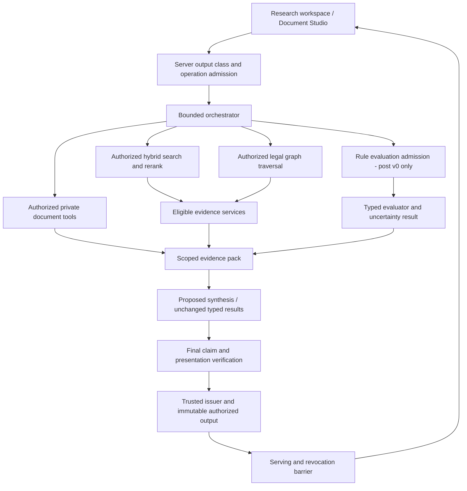

# Agentic AI architecture and workflows

**Status:** proposed future design; see [extension status and precedence](README.md). This is neither an implemented service nor an operational legal SOP.

## 1. Architecture

Use a modular application and isolated local workers, rather than one network service per agent. A specialist is a logical role with a typed input, output and bounded set of tools. One local model may serve several roles; deterministic components are not artificially turned into model calls. Multiple model calls do not confer independent legal authority.

The orchestrator is not a source of truth. Evidence services resolve identities, anchors and access at the actual serving generation. The policy gate is outside the model, authorizes the output class before context assembly, gates any operative evaluation, and validates the final claim-bound content after synthesis. All delivery goes through the [serving barrier](SERVING_AND_REVOCATION_CONTRACT.md); see [final claim contract](FINAL_CLAIM_VERIFICATION_CONTRACT.md). The model cannot make the gate pass by declaring an answer verified. See [tool contracts](AGENT_TOOL_CONTRACTS.md) and [legal engine](DETERMINISTIC_LEGAL_ENGINE.md).

## 2. Logical responsibilities

| Role | Input | Output | Boundaries |
|---|---|---|---|
| Intent and fact analysis | User question and session facts | Intent alternatives; known/alleged/unknown facts; material questions | No guilt finding or assumed facts |
| Research planner | Question, scope, known facts, budget | Bounded typed tasks, dependencies and stop conditions | Cannot request privileged tools or choose a disciplinary action |
| Statute researcher | Provision identifiers, dates, query | Candidate provision versions, amendment and saving evidence | No inferred commencement |
| Case researcher | Issues, citations, query | Cases, passages, proceedings, treatment leads and contrary sources | No inferred overruling or holding |
| Graph researcher | Eligible seeds, relation filters, dates | Anchored paths and coverage gaps | No legal conclusion from connectivity |
| Applicability evaluator | Facts and eligible rule pack | Deterministic checks, blockers and missing predicates | No active legal rule execution at ledger v0 |
| Document workflow | Own-session files, approved template identity, relevant facts | Draft proposal or checks with source/field references | No official issuance, signing, shared indexing or auto-promotion |
| Evidence verifier | Proposed claims and cited anchors | Resolved support, contradiction, missing evidence or gate denial | A valid quote alone does not prove legal applicability |
| Synthesis | Validated evidence, unknowns, permitted findings | Research report or conditional response | No unsupported mandatory steps |
| Corpus enrichment (separate Admin jobs) | Staged eligible source | Candidate OCR, entities, links, impact leads | No autonomous publication, authentication or approval |

Prefer ordinary direct search for exact lookup. Use orchestration only when query ambiguity, multiple subquestions or relational exploration warrants it. No automatic multi-agent fan-out for every search. Use parallel tasks only for independent, scoped work; merge by evidence identity, not by majority vote.

## 3. Workflow and state

Proposed research state machine:

`CREATED → FACTS_PENDING | PLANNED → RUNNING → VERIFYING → RESEARCH_RESULT | CONDITIONAL_RESULT | ABSTAINED`

Terminal alternatives: `CANCELLED`, `BUDGET_EXHAUSTED`, `FAILED`, `INVALIDATED`. Status codes here are workflow states, not legal status axes.

- At creation, bind authenticated actor, session, operation class, site release generation, active exclusions/withdrawals, tool and model versions, and relevant fact revision. Server derives these values; client/model values cannot widen scope.
- Store a durable workflow record and immutable task attempts; checkpoint completed read-only tasks. When input facts change, invalidate dependent tasks and replan. On restart, re-check scope and generation; retry only idempotent work.
- Define bounded task count, graph depth, result limit, model token budget, elapsed time, concurrency and retry limits per workflow class. Proposed numerical defaults are benchmark inputs, not release specifications (e.g. 8 tool calls, 3 graph hops, 30 seconds for an interactive research workflow, configurable by policy). Long research jobs run with progress and cancellation rather than blocking the UI.
- Ask a small number of material questions where answers affect legal scope, version, authority or route. Allow explicit UNKNOWN. Do not silently fabricate dates, rank, service status, procedural stage, or events.
- Revalidate authorization at each tool call. All content delivery, including queued frames, downloads and reconnects, is serialized at the serving barrier; no earlier check grants a reusable delivery permission. Invalidate affected work on a fence change. A pinned historical snapshot never overrides active exclusions.
- The verifier must resolve anchors against eligible originals/derivatives, check source status and identify unsupported or contrary claims. For claim entailment, use independently tested methods and qualified review where required; a second model's agreement is not sufficient.
- Record concise user-visible research actions, sources, rule checks, limitations and gaps. Do not require or persist private model chain-of-thought. Trace replay records inputs/outputs only under session privacy rules; model replay need not be byte-identical.

## 4. User workflows

**Simple lookup:** exact citation/case ID → identifier resolver → ranked source results → original PDF. No generative model needed.

**Multi-source research:** question → lexical/semantic searches → entity seeds → bounded graph traversal → original passage resolution → evidence pack → source-linked research synthesis when authorised by a later research-generation gate. Surface alternative interpretations and missing coverage. Candidate propositions are not authoritative statements and do not bypass ordinary UI visibility restrictions.

**Future Commander Assistant:** explicit facts and event dates → relevant legal versions and candidate routes → validated deterministic constraints → permitted conditional guidance, unresolved facts and competent human review. No autonomous sanction, charge selection, finding, deadline invention or execution. The existing Scenario Advisory Engine remains the controlling product workflow.

**Future Document Studio:** authenticated private session → classify/extract working documents → confirm material fields → select eligible template version → check using the same approved rule pack as generation → cite each check → editable draft or readiness report. Keep pass/fail/unknown/not applicable/not checked/missing distinct. No aggregate legal-validity score. Export is an explicit user action, never an official issuance or approval.

**Admin continuous ingestion:** staged eligible source → isolated parsing/OCR and candidate linking → impact leads and scoped dependency holds according to Document Studio §§3.3/8.1 → explicit Admin publication when eligible. An agent cannot dismiss a credible trigger, lift a hold or publish independently. No source ingestion from user research or Document Studio context.

## 5. Professional user experience

Use the existing research workspace, not a separate generic chatbot. Simple search stays fast. For complex research display progress by meaningful steps, cancellable tasks, sources examined, expandable evidence cards, conflicting authority, controlling date(s), missing facts and why an answer is restricted. Keep original PDF navigation one action away. Clearly differentiate retrieval result, candidate summary, reviewed research and permitted legal guidance. Show partial results and reasons for abstention; never disguise a blocked legal gate with a confident prose answer.

A research user may switch between commander-friendly and detailed evidence views without losing the current workspace. Personal research history follows session retention and ownership controls. No rank tiers. Functional and visual review must exercise actual research journeys, not only screenshots or unit tests.

## 6. Cycle 13 compatibility

No new live agent implementation required. Prefer reusable, typed search/catalogue/graph/evidence services, stable source and page anchors, cancellation and explicit status fields **where already compatible with current B0/B1 scope**. The later orchestrator calls application service interfaces via a controlled broker, not direct SQL, filesystem or general shell tools. See [roadmap](EVALUATION_AND_ROADMAP.md) for gated delivery.

## 7. Durable execution and workspace protocol (INT-F08/F14)

Combine deterministic phase gates with model-proposed research DAGs. Validate DAG acyclicity, registered tools, typed arguments, dependencies, owner scope, output class and budget before scheduling; reject undeclared edges or privileges. Exact lookup bypasses the DAG. Use the existing durable job mechanism initially; do not introduce a separate workflow engine without measured benefit.

Persist workflow ID, actor/session, serving revision, fact revision, plan revision, node ID, input-dependency digest, attempt number, lease expiry and monotonically increasing fencing token. A completion is accepted by compare-and-set only if workflow is active, lease token/current plan and fact revision match, dependency digests and current eligibility still hold. Stale results are discarded, not attached to a replan. Use one cumulative resource budget across retries and replans; no reset on restart. Reuse only unaffected nodes whose entire input and policy dependency set remains valid. Bound parallelism and queue admission. Cancellation immediately prevents attachment; cooperative cancellation followed by process termination after a measured grace period. Future private draft writes require a unique idempotency key scoped to owner/session/operation/input revision and atomic result record, so retries cannot duplicate writes. Never retry privileged operations to evade policy.

Synthetic recovery trace: attempt A1 obtains fence 7 for node N at fact revision 3; user edits a material date to revision 4 and scheduler invalidates N, issues fence 8 for N2; A1 finishes late and CAS rejects it; only N2's result may attach. A crash after a private draft commit but before acknowledgment returns the same idempotent result, not a second draft. A revoked source invalidates all dependent nodes and pending delivery independently of worker cancellation.

Workspace state is server-owned and owner-scoped: workspace ID, current tabs and comparison references, fact prompts, pinned copy/page (optional derivative span), selected result and immutable result version, coverage and conflict flags. A typed progress event contains workflow ID, sequence (monotone per workflow), task ID, stage, status, redacted counts, permitted evidence/result IDs, and invalidation references. It never carries unverified substantive model prose. Reconnect via an authenticated fresh snapshot and monotone sequence; do not replay stale frames without the serving fence. Client removes invalidated application-controlled fragments, focus and links, and explains why. Preserve permitted partial results; mark completeness/coverage and cancellation. Commander/research view toggle shares workspace state, not privileges.

Compare fixed DAG, bounded dynamic DAG and hybrid phase-gated planning on identical blind tasks: completion, material-question precision, adverse discovery, unsupported claims, tool calls, tail latency and resources. Add dynamic replan or external framework only when it demonstrably improves capability with equal policy behavior. Test kill/restart before and after CAS, duplicate submission, fact edits, revocation, cancellation during parallel work and keyboard-only search-to-comparison-to-source journeys. No live agent requirement in C13.

## 8. Atomic activation and budget reservations (R2-N08)

Use the authoritative job service as sole writer of **visible** private draft/result records. Workers can write owner-scoped non-visible staging files only. A worker never publishes a draft or attaches a result itself. The first visible activation and idempotency receipt are a single transaction, serialized with session revocation/fact/plan revision and current serving-policy changes (coordinator ordering; no direct worker DB bypass). At commit recheck trusted actor/session/retention epoch, operation class, active uncancelled workflow, exact node and input digest, current plan/fact revision, matching attempt fence **and unexpired lease** from server-owned clock, dependency/approval state, staging digest, and reservation. If any check fails, do not activate or write a success receipt; dispose staging under session policy. Store immutable file first in protected staging; the transactional pointer grants visibility only after this check. Crash before commit leaves orphan non-visible staging; crash after commit returns same receipt on authorized retry; no double activation. Idempotency key covers owner, session/retention epoch, operation, workflow/node, full input/revision digest. A stale retry cannot reveal old result after revocation; check current delivery authorization.

Reserve resource allowance atomically before scheduling any task or invoking an external worker. Per-workflow ledger tracks configured maximum, committed consumption, outstanding reservations and released remainder (units separately: calls, tokens, time/deadline, bytes; host concurrency separate). Under CAS/transaction require consumed + all outstanding + proposed worst-case reserve ≤ limit; issue attempt-specific reservation token and lease. Charge actual metered usage against reserve, stop at limit, release unused only after execution is confirmed stopped and usage settled. Crash/unknown usage conservatively charges outstanding maximum until independently reconciled; no budget reset or double-credit. Cancellation closes attachment immediately but does not free resource reservation until worker stops. Replan shares same ledger and deadline.

Synthetic trace: budget 10 calls, consumed 6, outstanding 0; tasks P and Q each request 3. P reserves 3 atomically; Q sees available 1 and waits/denies. P uses 2 and returns 1 unused after termination: consumed 8, available 2, Q still cannot reserve 3. Attempt A stages draft H at lease expiry t=20; at t=21 even with no replacement, activation fails; cancel/fact edit just before commit also fails. Valid A2 commits pointer+receipt once; lost ack then retry returns same result only if current owner and eligibility pass. Tests INT-16 include each boundary and parallel reservation race.
